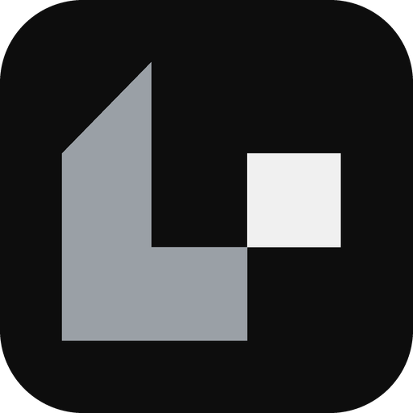
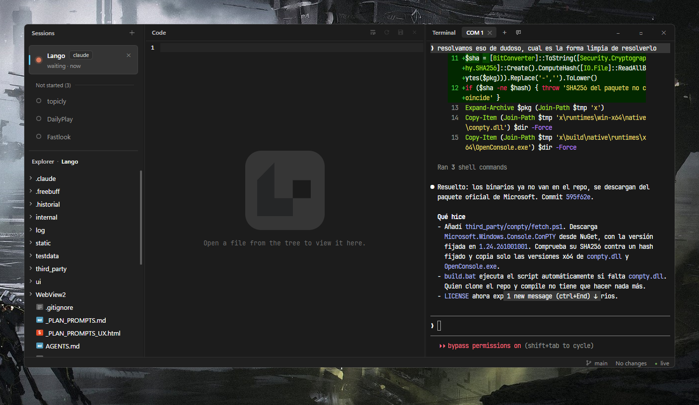
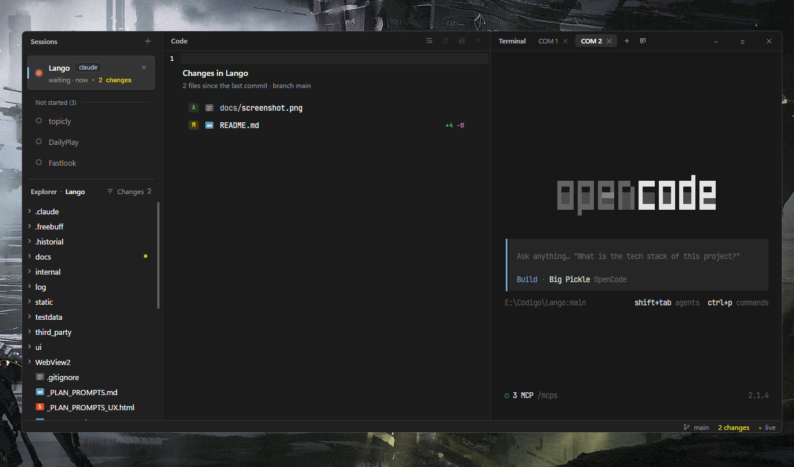

<h1 align="center">
  
  Lango
</h1>

<p align="center">
  
  
  
  
  
</p>

<p align="center">
  <strong>A lightweight orchestrator for CLI coding agents.</strong><br/>
  Run Claude Code, OpenCode, Codex CLI, Antigravity CLI and more, on several projects at once,<br/>
  with several terminals per project, in one small window.
</p>

<p align="center">
  
  <br/><br/>
  
</p>

## Who it is for

Built for the **enthusiastic vibe coder who is just getting familiar with git**. You talk to your agent; Lango shows you, without a single git command, what it changed:

- a counter of changed files on every project card,
- a colored diff per file, with next/previous change navigation,
- a changes-only filter in the file tree.

And it stays out of your way: **low RAM, a ~14 MB executable and no bundled browser**, so it runs next to your agents instead of competing with them.

## Features

- **Many projects at once:** one card per project with live agent status (waiting, busy, idle).
- **Up to 5 terminals per project:** real ConPTY, persistent scrollback, reconnects without losing output.
- **File tree and editor:** CodeMirror with live file watching, word wrap and save.
- **Prompt palette:** keep the prompts you keep retyping as plain `.md` files and insert them into the active terminal in one keystroke (see [Prompts](#prompts)).
- **Native feel:** frameless Windows 11 dark window, local-only server.

## Prompts

Save the prompts you reuse as Markdown files and paste them into any agent without leaving the keyboard.

- **Open it:** press `Ctrl+Shift+P`, or click the speech-bubble icon (💬) in the terminal header, next to the `+` button.
- **Search:** type to filter by name or folder; every word must match. A preview of the selected prompt appears beside the list.
- **Insert:** `↵` (or double-click) pastes the prompt into the active terminal. Multi-line prompts use bracketed paste, so nothing is sent until you press Enter.
- **Manage:** `Ctrl+N` creates a prompt, `Ctrl+E` edits the selected one in the built-in editor, right-click renames or deletes, and `Esc` closes the palette.
- **Plain files:** prompts live in the `prompts\` folder next to `Lango.exe`; subfolders act as groups. Edit them with any tool.

## Supported agents

<p>
  <kbd>Claude Code</kbd> <kbd>OpenCode</kbd> <kbd>Codex CLI</kbd> <kbd>Antigravity CLI</kbd> <kbd>Gemini</kbd> <kbd>Aider</kbd>
  <kbd>Kilo</kbd> <kbd>Goose</kbd> <kbd>Cursor</kbd> <kbd>Crush</kbd> <kbd>Qwen</kbd> <kbd>Auggie</kbd> <kbd>Droid</kbd>
  <kbd>OpenHands</kbd> <kbd>Plandex</kbd> <kbd>Junie</kbd> <kbd>Hermes</kbd> <kbd>Freebuff</kbd> <kbd>Pi</kbd> + any CLI
</p>

## Build

Requires Go 1.26 and [Wails v2](https://wails.io) (`wails` in `PATH` or in `%USERPROFILE%\go\bin`).

```bat
build.bat
build\bin\Lango.exe
```

`build.bat` also downloads `conpty.dll` and `OpenConsole.exe` from the official Microsoft NuGet package (pinned version and SHA256) the first time.

```bat
go test -race ./...
```

Set `LANGO_UI_DIR` to the `ui\` folder to try frontend changes without rebuilding.

## License

[MIT](LICENSE). `conpty.dll` and `OpenConsole.exe` (Microsoft, MIT) are downloaded at build time. The bundled JetBrains Mono font is under the [SIL OFL 1.1](ui/vendor/fonts/OFL.txt).
